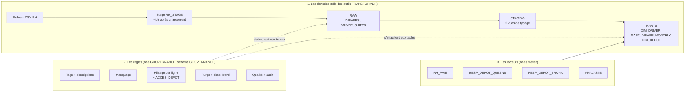
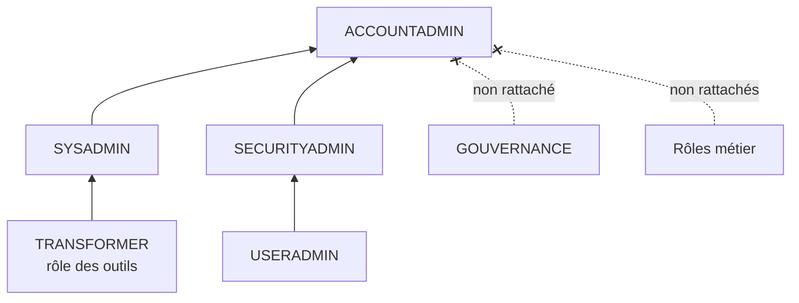
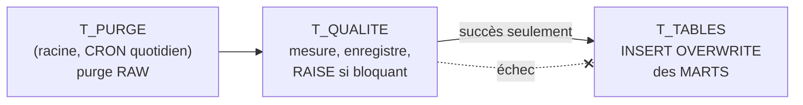

# Cours — Gouverner un entrepôt de données personnelles avec Snowflake

> Support d'apprentissage pour le brief **« Gouverner l'entrepôt NYC Taxi »** (Hudson Cab Partners).
> Il explique **les enjeux**, puis **chaque notion et chaque techno** dont vous aurez besoin, dans l'ordre où vous les rencontrerez.
> Les exemples SQL portent volontairement sur un cas **générique** (une table `CLIENTS`) : ils montrent le geste, pas la solution du brief. À vous de les transposer à partir du `CONTRAT_GOUVERNANCE.md`.

---

## Sommaire

1. [Les enjeux : pourquoi ce brief existe](#1-les-enjeux--pourquoi-ce-brief-existe)
2. [Le droit : lire le RGPD en Data Engineer](#2-le-droit--lire-le-rgpd-en-data-engineer)
3. [La veille réglementaire : un dispositif, pas une recherche](#3-la-veille-réglementaire--un-dispositif-pas-une-recherche)
4. [Snowflake : les fondamentaux](#4-snowflake--les-fondamentaux)
5. [Le contrôle d'accès (RBAC) : rôles, privilèges, propriété](#5-le-contrôle-daccès-rbac--rôles-privilèges-propriété)
6. [Charger des fichiers : format, stage, COPY INTO](#6-charger-des-fichiers--format-stage-copy-into)
7. [Les couches RAW / STAGING / MARTS et la règle « ne jamais recréer »](#7-les-couches-raw--staging--marts-et-la-règle--ne-jamais-recréer-)
8. [Le catalogue : descriptions, tags, INFORMATION_SCHEMA, lignage](#8-le-catalogue--descriptions-tags-information_schema-lignage)
9. [Le masquage dynamique des colonnes](#9-le-masquage-dynamique-des-colonnes)
10. [Le filtrage des lignes (Row Access Policy)](#10-le-filtrage-des-lignes-row-access-policy)
11. [La conservation : purge, Time Travel, Fail-safe](#11-la-conservation--purge-time-travel-fail-safe)
12. [La qualité des données en SQL](#12-la-qualité-des-données-en-sql)
13. [Les tâches planifiées (TASK) et les graphes de tâches](#13-les-tâches-planifiées-task-et-les-graphes-de-tâches)
14. [L'audit : ACCOUNT_USAGE, ACCESS_HISTORY, QUERY_HISTORY](#14-laudit--account_usage-access_history-query_history)
15. [Les bonus : classification, alertes, agrégation](#15-les-bonus--classification-alertes-agrégation)
16. [Git : un dépôt public sans fuite](#16-git--un-dépôt-public-sans-fuite)
17. [Aide-mémoire et glossaire](#17-aide-mémoire-et-glossaire)

---

## 1. Les enjeux : pourquoi ce brief existe

### 1.1 La situation en une phrase

Hudson Cab a **déjà** les données (un fichier RH avec noms, e-mails, téléphones, dates de naissance, licences) et **déjà** du SQL qui les recopie (celui de Priya), mais **personne** ne sait dire qui peut voir quoi, combien de temps on garde, ni si les données sont justes. Trois services réclament un accès. Votre rôle : **mettre les garde-fous avant d'ouvrir la porte.**

### 1.2 La question unique du brief

> **Qui peut voir quelle donnée, pendant combien de temps, et peut-on s'y fier ?**

Elle se découpe en quatre piliers. Chaque pilier correspond à un jour, à une compétence évaluée et à des objets Snowflake :

| Pilier | Question | Ce que vous construisez | Compétence |
|---|---|---|---|
| **Savoir** (règles) | Quelles lois s'appliquent ? Le contrat les respecte-t-il ? | Note de veille, fiches, confrontation contrat/textes | **C4** |
| **Savoir** (données) | Qu'y a-t-il dans l'entrepôt ? Qui en répond ? | Inventaire, descriptions, tags, vue catalogue, lignage | **C20** |
| **Protéger** | Qui voit quelles lignes, quelles valeurs ? | Rôles, masquage, filtrage par ligne, table de correspondance | **C21** |
| **Conserver / Fiabiliser / Prouver** | Combien de temps ? Est-ce juste ? Qui a lu ? | Purge, Time Travel, règles de qualité, tâches, audit | **C19 + C21** |

### 1.3 Les enjeux concrets pour l'entreprise

**Enjeu juridique.** Les données des chauffeurs sont des **données personnelles**. Depuis que la filiale parisienne décide de leur traitement, le **RGPD** s'applique (vous le démontrerez par l'article 3). En cas de manquement : sanction de la CNIL jusqu'à **20 M€ ou 4 % du chiffre d'affaires mondial** (art. 83), injonction de cesser le traitement, atteinte à l'image.

**Enjeu de sécurité.** Un entrepôt où tout le monde lit tout est une fuite qui attend son heure : un compte compromis, un export Excel envoyé par erreur, un tableau de bord partagé trop largement. Le principe de **moindre privilège** limite les dégâts : chacun ne voit que ce dont son métier a besoin.

**Enjeu de confiance.** Les chauffeurs doivent pouvoir faire confiance à leur employeur ; la direction doit pouvoir faire confiance aux chiffres. Une table d'activité avec des services rattachés à des chauffeurs inexistants produit de faux indicateurs — et de fausses paies.

**Enjeu d'exploitation.** Les règles doivent **survivre** au pipeline. Une politique de masquage qui disparaît chaque nuit quand une table est recréée ne protège rien. D'où l'exigence : tout en **SQL versionné et rejouable**, jamais à la main dans l'interface.

**Enjeu de preuve (accountability).** Le RGPD ne demande pas seulement d'être conforme, il demande de **pouvoir le démontrer** (art. 5.2). D'où le cahier de tests, la requête d'audit, le registre avec ses preuves.

### 1.4 Pourquoi c'est le travail d'un Data Engineer

Le juriste dit **ce qui est exigé**, la direction **décide**, mais c'est le Data Engineer qui **traduit en mécanismes** : un `GRANT`, une politique, une tâche planifiée, une requête d'audit. Le RGPD appelle cela la **protection des données dès la conception et par défaut** (art. 25) : la protection est construite dans le système, pas ajoutée après coup.

### 1.5 Le schéma du brief, lu de haut en bas



Trois idées à retenir de ce schéma :

1. **Les données avancent** de gauche à droite ; seul le rôle des outils les fait avancer.
2. **Les règles s'attachent aux tables** ; elles sont écrites par un rôle qui **ne lit pas** les données (séparation des pouvoirs).
3. **Les lecteurs ne lisent que MARTS**, et passent toujours par les règles. Personne ne lit RAW, sauf le pipeline.

---

## 2. Le droit : lire le RGPD en Data Engineer

### 2.1 Le vocabulaire indispensable

| Notion | Définition (RGPD) | Dans le brief |
|---|---|---|
| **Donnée personnelle** | Toute information se rapportant à une personne physique identifiée ou **identifiable**, directement ou indirectement (art. 4.1) | nom, e-mail, téléphone… mais aussi `driver_id`, et même les heures travaillées d'un `driver_id` |
| **Traitement** | Toute opération : collecte, enregistrement, consultation, copie, effacement… (art. 4.2) | un `COPY INTO`, un `SELECT`, un `INSERT OVERWRITE`, un `DELETE` sont des traitements |
| **Responsable du traitement** | Celui qui **détermine les finalités et les moyens** (art. 4.7) | celui qui **décide** |
| **Sous-traitant** | Celui qui traite **pour le compte** du responsable (art. 4.8, encadré par l'art. 28) | celui qui **exécute** |
| **Pseudonymisation** | Remplacer l'identité par un identifiant, la table de correspondance étant gardée à part (art. 4.5) | `driver_id` : la donnée **reste personnelle** (considérant 26) |
| **Anonymisation** | Rendre l'identification **impossible**, de façon irréversible | le RGPD ne s'applique plus ; rarement atteint en pratique |

> **Piège classique** : croire qu'un identifiant interne (`D0003`) n'est pas une donnée personnelle. Il l'est : avec la table `DRIVERS`, il désigne quelqu'un. C'est une donnée **pseudonymisée**, pas anonyme.

### 2.2 Identifiant direct, indirect, ou pas une donnée personnelle

- **Direct** : la valeur seule désigne la personne (nom + prénom, e-mail, numéro de licence).
- **Indirect** : la valeur seule ne suffit pas, mais combinée à d'autres elle permet de retrouver quelqu'un (date de naissance + dépôt ; `driver_id` ; une recette journalière rattachée à un `driver_id`).
- **Non personnelle** : ne dit rien d'une personne (le nombre de places d'un garage).

Une **colonne calculée** à partir d'une donnée personnelle **est** une donnée personnelle : `first_name || ' ' || last_name AS driver_name` est un nom, `tenure_years` (ancienneté) décrit une personne.

### 2.3 Le champ d'application territorial : l'article 3

C'est la question piège du jour 1 : *des chauffeurs new-yorkais, le RGPD ?*

L'article 3 a deux paragraphes principaux ; **il suffit qu'un seul s'applique** :

| Paragraphe | Ce qu'il regarde | Question à se poser |
|---|---|---|
| **Art. 3.1** — critère de l'établissement | **l'entreprise** | Le traitement a-t-il lieu *dans le cadre des activités d'un établissement* du responsable ou du sous-traitant **sur le territoire de l'Union**, que le traitement ait lieu dans l'Union **ou non** ? |
| **Art. 3.2** — critère du ciblage | **les personnes** | Une entreprise **sans établissement** dans l'UE cible-t-elle des personnes **qui se trouvent dans l'UE** (offre de biens/services, suivi du comportement) ? |

Méthode : pour chaque paragraphe, écrivez « oui / non, parce que… » avec **un fait du contexte**. Indices :
- Où est Hudson Cab Europe ? Que fait-elle de ces données (relisez : « *c'est elle qui décide désormais* ») ?
- Le considérant 14 rappelle que la protection s'applique aux personnes physiques **quelle que soit leur nationalité ou leur lieu de résidence**.
- Le considérant 22 et les **lignes directrices 3/2018 du CEPD** précisent ce qu'est un « établissement » (exercice effectif et réel d'une activité au moyen d'une installation stable : une filiale l'est).

### 2.4 Qui décide, qui exécute

```
  Groupe Hudson Cab (New York) ── a confié la gestion des données du personnel ──►
  Hudson Cab Europe (Paris)    ── DÉCIDE des finalités et des moyens ──────────────►  ?
  Snowflake (hébergeur cloud)  ── EXÉCUTE, sur instruction, sans décider ──────────►  ?
```

À vous de nommer les deux rôles, avec l'article. Puis : quelle **autorité de contrôle** est compétente (art. 55 et 56 : autorité de l'établissement principal) ?

### 2.5 Les principes de l'article 5, traduits en objets Snowflake

C'est **le tableau le plus important du cours** : il relie le droit à la technique.

| Principe (art. 5) | Ce qu'il exige | Mécanisme Snowflake dans le brief |
|---|---|---|
| **a. Licéité, loyauté, transparence** | une base légale, une information des personnes | hors périmètre technique ; à citer dans le registre (base légale : contrat de travail, obligation légale — art. 6.1.b et c) |
| **b. Limitation des finalités** | utiliser les données pour un but déterminé | un **rôle par besoin** (paie, gestion de dépôt, analyse) |
| **c. Minimisation** | ne montrer/garder que le nécessaire | **masquage**, **suppression de colonnes**, **filtrage par ligne** |
| **d. Exactitude** | des données exactes et à jour | **règles de qualité** enregistrées chaque jour |
| **e. Limitation de la conservation** | ne pas garder plus longtemps que nécessaire | **purge** (R1), **Time Travel** limité (R2), **stage vidé** (R3) |
| **f. Intégrité et confidentialité** | sécurité appropriée | **RBAC**, séparation des pouvoirs, chiffrement (natif Snowflake) |
| **5.2 Responsabilité (accountability)** | **pouvoir démontrer** la conformité | **cahier de tests**, **ACCESS_HISTORY**, **registre** avec preuves, **catalogue** |

Autres articles utiles pour la note de veille :
- **Art. 6** : bases légales. **Art. 88** : traitements dans le cadre des relations de travail.
- **Art. 17** : droit à l'effacement (votre purge en est l'outil).
- **Art. 25** : protection dès la conception et par défaut.
- **Art. 28** : contrat avec le sous-traitant. **Art. 30** : registre des activités de traitement. **Art. 32** : sécurité. **Art. 33** : notification d'une violation sous 72 h.
- **Chapitre V (art. 44 à 49)** : transferts hors UE. *Votre compte Snowflake est-il hébergé dans une région UE ou US ?* (`SELECT CURRENT_REGION();`). Si les données sont hébergées aux États-Unis par un responsable établi en France, c'est un **transfert** qui doit être encadré (décision d'adéquation *EU-US Data Privacy Framework* de juillet 2023, ou clauses contractuelles types). À vérifier et sourcer dans votre veille.

### 2.6 Les durées de conservation : ce que dit (et ne dit pas) le RGPD

- Le RGPD **ne fixe aucune durée chiffrée**. Il impose une durée **justifiée par la finalité** (art. 5.1.e).
- Les durées chiffrées viennent du **droit national** (code du travail, droit fiscal, prescriptions) et des **recommandations de la CNIL**.
- Le **référentiel CNIL « gestion du personnel »** (novembre 2019), section 7, distingue :
  - **base active** : les données utilisées au quotidien, accessibles aux services concernés ;
  - **archivage intermédiaire** : les données qu'on doit **garder sans s'en servir** (obligation légale, contentieux possible), dans un espace **séparé et à accès restreint** ;
  - **suppression** (ou anonymisation) au terme.
- Exemple à chercher dans le tableau du référentiel : le **registre unique du personnel**, sa durée, et le texte du **code du travail** français sur lequel elle s'appuie.

> **La question qui fait la différence** : une durée tirée du code du travail **français** s'applique-t-elle telle quelle à des contrats signés **à New York** ? Et le droit new-yorkais impose-t-il, lui, de garder certaines données (paie, heures) plus longtemps ? Ce sont des questions de juriste : la veille les **signale**, elle ne les tranche pas (section 5 de `VEILLE.md`).

> **Autre question qui fait la différence** : un chauffeur parti il y a trois ans doit-il rester dans la même table, **avec les mêmes accès**, qu'un chauffeur en poste ? Relisez la notion de base active / archivage intermédiaire.

### 2.7 Le registre des traitements (art. 30)

Document qui décrit, pour chaque traitement : nom, finalité, catégories de personnes et de données, destinataires, durées, mesures de sécurité, transferts. Le brief vous en demande une **version réduite**, mais avec une exigence forte : **chaque affirmation pointe vers une preuve** (une requête, un fichier, un test).

---

## 3. La veille réglementaire : un dispositif, pas une recherche

### 3.1 Définition

Une veille est un **système qui continue de vous prévenir** quand un texte change. Une recherche faite une fois n'est pas une veille. Un dispositif complet a quatre éléments :

| Élément | Exemple |
|---|---|
| **Des sources officielles** (au moins trois) | CNIL (actualités + flux RSS), CEPD/EDPB (actualités, lignes directrices), EUR-Lex (Journal officiel de l'UE), Légifrance |
| **Une fréquence** | hebdomadaire pour la lecture, mensuelle pour la synthèse |
| **Un outil de suivi en place** | lecteur RSS (Feedly, Inoreader, Thunderbird), alerte e-mail, lettre d'information — **vraiment abonné**, avec capture |
| **Un circuit de décision** | qui lit, qui décide qu'une nouveauté demande une action, où on la trace |

Sources secondaires (blogs, cabinets d'avocats, newsletters professionnelles) : utiles pour **repérer** un texte, jamais pour le **citer**. Une fiche cite toujours la **source officielle**, avec sa date.

### 3.2 Anatomie d'une bonne fiche de veille

```
Fiche n — <titre court>
- Source     : organisme, titre exact, lien officiel
- Date       : date de publication · date de consultation
- Ce que dit le texte : 3 phrases max, avec VOS mots (pas de copier-coller)
- Ce que ça change pour NOTRE entrepôt : tables, colonnes, rôles, règles concernés
- Action     : aucune / à faire dans le brief / à signaler à la direction
```

Le test d'une bonne fiche : **la dernière ligne renvoie à un objet concret** (`DIM_DRIVER.email`, la règle R1, le rôle `ANALYSTE`). Une fiche qui ne change rien à l'entrepôt est un résumé, pas une fiche de veille.

Idées de fiches (une par texte) : RGPD art. 3 ; RGPD art. 5 (minimisation, conservation) ; lignes directrices CEPD 3/2018 ; référentiel CNIL gestion du personnel ; CNIL durées de conservation ; CNIL sécurité des données ; chapitre V et décision d'adéquation UE–US.

### 3.3 Confronter le contrat aux textes

Méthode : **une ligne par règle du contrat** (R1, R2, R3, matrice des accès, règles de qualité). Pour chacune : que disent les textes ? conforme ? écart ? proposition ?

Points d'attention (pistes à instruire, pas des réponses toutes faites) :
- **R1 (5 ans)** : d'où vient ce chiffre ? Le contrat distingue-t-il base active et archivage intermédiaire ? Que voit un responsable de dépôt d'un chauffeur parti il y a 4 ans ?
- **R2 (Time Travel 1 jour)** : Snowflake garde **en plus** 7 jours de Fail-safe sur les tables permanentes (cf. §11). Le délai réel de disparition est-il celui du contrat ?
- **Matrice** : chaque accès est-il justifié par un besoin ? L'analyste a-t-elle besoin de l'année de naissance ? Un responsable de dépôt a-t-il besoin de la date de naissance ?
- **Transfert** : le contrat a été rédigé **avant** le transfert de la gestion à Paris ; dit-il quelque chose de la région d'hébergement ?

Règle d'or : **vous signalez, vous ne réécrivez pas le contrat**. Les écarts vont dans `VEILLE.md` (section 4) **et** dans le `README.md`.

---

## 4. Snowflake : les fondamentaux

### 4.1 L'architecture en trois couches

```
┌───────────────────────────────────────────────────────────────┐
│  SERVICES CLOUD : authentification, RBAC, métadonnées,        │
│  optimiseur, politiques, tags, historique des accès           │
├───────────────────────────────────────────────────────────────┤
│  CALCUL : les WAREHOUSES (clusters de calcul, facturés à      │
│  la seconde, suspendus automatiquement)                       │
├───────────────────────────────────────────────────────────────┤
│  STOCKAGE : les données, en micro-partitions colonnaires,     │
│  chiffrées, immuables (d'où Time Travel)                      │
└───────────────────────────────────────────────────────────────┘
```

Conséquences pratiques :
- **Stockage et calcul séparés** : sans warehouse actif (ou sans droit `USAGE` dessus), aucune requête ne s'exécute.
- **Les règles de gouvernance vivent dans la couche services** : elles s'appliquent à **chaque requête**, quel que soit l'outil (Snowsight, Python, Power BI).
- **Les micro-partitions sont immuables** : un `DELETE` écrit de nouvelles partitions et garde les anciennes un temps (Time Travel, Fail-safe).

### 4.2 La hiérarchie des objets

```
Compte (account)
 ├── Rôles, utilisateurs, warehouses        ← objets de niveau compte
 └── Base (NYC_TAXI)
      └── Schéma (RAW, STAGING, MARTS, GOUVERNANCE)
           ├── Tables, vues
           ├── Stages, formats de fichier
           ├── Tags, politiques de masquage, politiques d'accès par ligne
           └── Tâches
```

Un nom complet s'écrit `BASE.SCHEMA.OBJET` (ex. `NYC_TAXI.MARTS.DIM_DRIVER`). Écrivez toujours les noms complets dans vos scripts : vous n'aurez pas de surprise selon le contexte de la feuille.

### 4.3 Les éditions

Le masquage dynamique, les politiques d'accès par ligne, les tags, `ACCESS_HISTORY` et Time Travel au-delà de 1 jour exigent l'édition **Enterprise** (ou supérieure). Le compte d'essai permet de la choisir : **ne vous trompez pas à l'inscription**.

### 4.4 Snowsight

L'interface web : feuilles SQL (Workspaces), explorateur de bases (onglet *Databases* / *Catalog*), onglets *Details* (tags), *Lineage*, *Graph* et *Run History* des tâches. **Chaque feuille garde son propre rôle et son warehouse**, affichés en haut à droite : vérifiez-les avant chaque exécution.

`Cmd/Ctrl + Maj + Entrée` exécute tout le script, mais s'arrête à la première erreur sans le signaler clairement → **terminez chaque script par une requête de vérification**.

---

## 5. Le contrôle d'accès (RBAC) : rôles, privilèges, propriété

### 5.1 Le modèle

Snowflake applique un **contrôle d'accès fondé sur les rôles** (RBAC) :

```
Utilisateur ──(GRANT ROLE)──► Rôle ──(GRANT privilège)──► Objet
```

- On ne donne **jamais** de droit directement à un utilisateur : on le donne à un **rôle**, et on donne le rôle à l'utilisateur. (Contrainte du brief : *les règles sont portées par des rôles, jamais par des utilisateurs nommés*.)
- Chaque objet a **un propriétaire** : le rôle qui l'a créé. Le propriétaire a tous les droits sur l'objet et peut en accorder.

### 5.2 La chaîne des USAGE

Pour lire une table, un rôle doit avoir **toute la chaîne** :

```
USAGE sur le WAREHOUSE  (pour exécuter)
USAGE sur la BASE
USAGE sur le SCHÉMA
SELECT sur la TABLE
```

Il manque un maillon → erreur `Object does not exist or not authorized`. Snowflake ne dit pas *lequel* : c'est pour cela que le brief vous fait tenir une **carte des droits** (`ACCES.md`).

> **Astuce clé du brief** : `USAGE` sur un schéma **sans** `SELECT` sur ses tables permet de **voir** que les tables existent (et donc d'y attacher des politiques) **sans lire leur contenu**. C'est exactement ce qu'il faut au rôle `GOUVERNANCE`.

### 5.3 Les droits sur les objets futurs

```sql
GRANT SELECT ON FUTURE TABLES IN SCHEMA EXEMPLE.DONNEES TO ROLE ANALYSTE_EX;
GRANT SELECT ON FUTURE VIEWS  IN SCHEMA EXEMPLE.DONNEES TO ROLE ANALYSTE_EX;
```

Sans cela, une table **recréée** (ou une vue `CREATE OR REPLACE`) perd ses droits, et le rôle « perd » la table. Ce type de droit demande `MANAGE GRANTS` (de fait, `ACCOUNTADMIN` ici). Alternative ponctuelle pour une vue : `CREATE OR REPLACE VIEW … COPY GRANTS`.

### 5.4 Les rôles système et la hiérarchie



- `GRANT ROLE A TO ROLE B` : **B hérite** de tous les droits de A.
- Dans le kit, `TRANSFORMER` est rattaché à `SYSADMIN`, donc `ACCOUNTADMIN` **hérite** du droit de lire RAW et MARTS. Le contrat le prévoit : *l'administrateur voit les tables, mais les colonnes personnelles y sont masquées pour lui* — et il ne voit **aucune ligne** des tables RH.
- Comment est-ce possible s'il a le droit de lire ? Parce que les politiques testent **le rôle actif** (`CURRENT_ROLE()`), pas la puissance du rôle (voir §9.4).

### 5.5 Rôle principal et rôles secondaires — LE piège n° 1 des tests

- `USE ROLE X` choisit le **rôle principal**.
- Par défaut, Snowflake active aussi **tous vos autres rôles** comme **rôles secondaires** : leurs **droits de lecture s'additionnent**.
- Les politiques, elles, regardent `CURRENT_ROLE()`, c'est-à-dire **le rôle principal seulement**.

Résultat : sans précaution, un test « `GOUVERNANCE` ne peut pas lire `DIM_DRIVER` » renvoie des lignes (grâce à un rôle secondaire). **Réflexe avant chaque test :**

```sql
USE SECONDARY ROLES NONE;
USE ROLE <rôle à tester>;
USE WAREHOUSE <warehouse>;
```

### 5.6 La séparation des pouvoirs

| Rôle | Peut | Ne peut pas |
|---|---|---|
| Rôle des outils (`TRANSFORMER`) | charger, transformer, posséder les tables, poser des tags (avec `APPLY` sur le tag) | écrire les politiques |
| `GOUVERNANCE` | créer tags et politiques, les attacher (`APPLY MASKING POLICY` / `APPLY ROW ACCESS POLICY` sur le compte) | lire les données |
| Rôles métier | lire MARTS selon la matrice | modifier quoi que ce soit |
| `ACCOUNTADMIN` | administrer le compte, accorder les droits « compte » | lire les données en clair |

Pourquoi ? Parce que **celui qui écrit la règle ne doit pas en profiter**, et que celui qui possède la donnée ne doit pas pouvoir désactiver la règle seul. Gardez en tête la question du modèle `ACCES.md` : *ce que cette carte permet à un rôle de défaire* (ex. : le propriétaire d'une table peut-il retirer un tag et donc démasquer une colonne ?).

---

## 6. Charger des fichiers : format, stage, COPY INTO

### 6.1 Les trois objets

| Objet | Rôle | Analogie |
|---|---|---|
| **Format de fichier** (`FILE FORMAT`) | dit **comment lire** le fichier : type (CSV), séparateur, en-tête, guillemets, espaces | le mode d'emploi |
| **Stage** | **zone de dépôt** des fichiers dans Snowflake, avant copie dans une table. Interne (stocké par Snowflake) ou externe (S3, Azure, GCS) | le quai de déchargement |
| **`COPY INTO`** | **copie** le contenu des fichiers du stage dans une table | le chariot élévateur |

### 6.2 Le déroulé

```
1. CREATE FILE FORMAT      (une fois)
2. CREATE STAGE            (une fois)
3. Déposer les fichiers    (Snowsight « + Files », ou PUT en ligne de commande)
4. LIST @stage             (vérifier qu'ils sont là)
5. COPY INTO table FROM @stage … PURGE = TRUE
6. LIST @stage             (vérifier qu'il est VIDE → règle R3)
```

### 6.3 Les options importantes de COPY INTO

```sql
COPY INTO EXEMPLE.RAW.CLIENTS
FROM (SELECT $1, $2, $3::date,                     -- $n = n-ième colonne du fichier
             METADATA$FILENAME,                    -- nom du fichier source (lignage)
             METADATA$START_SCAN_TIME              -- heure du chargement
      FROM @EXEMPLE.RAW.MON_STAGE)
FILES = ('clients.csv')
FILE_FORMAT = (FORMAT_NAME = EXEMPLE.RAW.MON_FORMAT_CSV)
ON_ERROR = ABORT_STATEMENT                          -- tout ou rien
PURGE = TRUE;                                       -- retire le fichier du stage après succès
```

- **Idempotence** : Snowflake garde **64 jours** l'historique des fichiers chargés dans une table. Relancer `COPY INTO` ne recharge pas un fichier déjà chargé → le chargement est **rejouable sans doublon** (sauf `FORCE = TRUE`).
- **`PURGE = TRUE`** : met en œuvre la règle **R3** (le fichier ne traîne pas sur le stage). Un fichier personnel oublié sur un stage est une copie non gouvernée.
- **Colonnes techniques** `_source_file`, `_loaded_at` : traçabilité (d'où vient la ligne, quand). Utile pour le lignage et le catalogue.
- **RAW = copie fidèle** : pas de nettoyage (`TRIM_SPACE = FALSE`). Les erreurs du fichier (dépôt `BRONX ` avec espace, téléphone vide…) restent visibles dans RAW, et c'est voulu : la qualité se **mesure** sur RAW.

---

## 7. Les couches RAW / STAGING / MARTS et la règle « ne jamais recréer »

### 7.1 Le rôle de chaque couche

| Couche | Contenu | Matérialisation | Qui lit |
|---|---|---|---|
| **RAW** | copie fidèle des fichiers + colonnes techniques | tables | le pipeline seulement |
| **STAGING** | typage, nettoyage léger, dédoublonnage | **vues** | le pipeline seulement |
| **MARTS** | tables prêtes pour les métiers | tables | les rôles métier |

Une **vue** ne stocke rien : elle relit RAW à chaque requête. Donc **ce qui protège les colonnes de RAW s'applique aussi à la vue** (le masquage est évalué avec le rôle qui interroge). C'est pourquoi on ne catalogue pas STAGING séparément.

### 7.2 `INSERT OVERWRITE` vs `CREATE OR REPLACE TABLE`

| Commande | Ce qu'elle fait | Tags, descriptions, politiques, droits |
|---|---|---|
| `CREATE OR REPLACE TABLE … AS SELECT` | **détruit** la table et en crée une **nouvelle** | **perdus** |
| `INSERT OVERWRITE INTO table SELECT …` | **vide** la table et la **remplit**, sans la recréer | **conservés** |
| `CREATE TABLE IF NOT EXISTS` | crée seulement si absente | conservés |

C'est le cœur de l'exigence *« les règles survivent à une exécution du pipeline »*. Le kit est déjà écrit ainsi (`00_tables_rh.sql` crée une fois, les fichiers `marts/` font `INSERT OVERWRITE`). **Ne le cassez pas** en modifiant les fichiers de Priya.

### 7.3 Le piège de la copie masquée

Le pipeline construit `DIM_DRIVER` à partir de ce que **son rôle voit**. Si le rôle des outils voit des valeurs masquées (`*****`), il écrit `*****` **en dur** dans la table, définitivement. Toute politique doit donc prévoir : **le rôle des outils voit en clair**. Même logique pour le filtrage : s'il ne voit aucune ligne de `DIM_DRIVER`, la jointure de `MART_DRIVER_MONTHLY` donnera des `driver_name` vides, **sans erreur**.

---

## 8. Le catalogue : descriptions, tags, INFORMATION_SCHEMA, lignage

### 8.1 Qu'est-ce qu'un catalogue ?

L'**inventaire documenté** des données : pour chaque table et chaque colonne, ce qu'elle **signifie**, d'où elle **vient**, à quel **rythme** elle change, **qui en répond**, et quelles **étiquettes** (sensibilité, donnée personnelle, conservation) elle porte. Sans catalogue, on ne peut ni protéger (on ne sait pas quoi), ni répondre à une demande d'accès ou d'effacement.

> « On ne protège pas ce que l'on n'a pas inventorié » : c'est pour cela que le jour 1 ne contient **aucune politique**.

### 8.2 Les descriptions : `COMMENT`

```sql
COMMENT ON TABLE  EXEMPLE.DONNEES.CLIENTS IS
  'Clients actifs : 1 ligne = 1 client. Source : export CRM quotidien. Mise à jour : chaque nuit. Responsable : équipe commerciale.';
COMMENT ON COLUMN EXEMPLE.DONNEES.CLIENTS.region IS
  'Région commerciale de rattachement (Nord, Sud, Est). Sert à filtrer les lignes par vendeur.';
```

Une bonne description de **table** dit : signification (1 ligne = ?), source, rythme de mise à jour, responsable.
Une bonne description de **colonne** dit ce que la valeur **signifie**, pas son nom répété (`email : l'email` ne documente rien). Précisez les conventions (vide = ?, unité, format).

Les descriptions se relisent dans `INFORMATION_SCHEMA.COLUMNS` (colonne `COMMENT`) et `INFORMATION_SCHEMA.TABLES`.

### 8.3 Les tags

Un **tag** est un objet de schéma qu'on **pose** sur un objet (table, colonne, schéma…) avec une **valeur**. Il **décrit** — et il peut **déclencher** une règle (masquage par tag, §9.5).

```sql
-- Créer (le propriétaire du schéma, ou un rôle avec CREATE TAG)
CREATE TAG IF NOT EXISTS EXEMPLE.GOUV.NIVEAU
  ALLOWED_VALUES 'public', 'interne', 'confidentiel'      -- liste fermée : toute autre valeur est refusée
  COMMENT = 'Niveau de sensibilité d''une table';

-- Autoriser un autre rôle à le poser
GRANT USAGE ON SCHEMA EXEMPLE.GOUV TO ROLE PIPELINE_EX;
GRANT APPLY ON TAG EXEMPLE.GOUV.NIVEAU TO ROLE PIPELINE_EX;

-- Poser (sur la table, ou sur une colonne)
ALTER TABLE EXEMPLE.DONNEES.CLIENTS SET TAG EXEMPLE.GOUV.NIVEAU = 'confidentiel';
ALTER TABLE EXEMPLE.DONNEES.CLIENTS MODIFY COLUMN email SET TAG EXEMPLE.GOUV.PII = 'email';
```

Points clés :
- **`ALLOWED_VALUES`** : impose le vocabulaire du contrat (section 3). Une faute de frappe est refusée : c'est une règle de qualité du catalogue.
- **Héritage** : un tag posé sur une table est **hérité** par ses colonnes (et un tag de schéma par ses tables). La fonction de lecture indique le `LEVEL` (TABLE ou COLUMN).
- **Qui crée, qui pose** : le rôle de gouvernance **crée** les tags ; le **propriétaire de la table** (rôle des outils) les **pose**, avec le privilège `APPLY` sur chaque tag.
- `SET TAG` est **rejouable** (il remplace la valeur précédente).

Lire les tags :

```sql
SELECT level, column_name, tag_name, tag_value
FROM TABLE(EXEMPLE.INFORMATION_SCHEMA.TAG_REFERENCES_ALL_COLUMNS('EXEMPLE.DONNEES.CLIENTS', 'table'));
```

`TAG_REFERENCES_ALL_COLUMNS` s'appelle **pour une table à la fois**. Pour plusieurs tables : un bloc par table, réunis par `UNION ALL`.

### 8.4 `INFORMATION_SCHEMA` : ce que voit le rôle qui interroge

Chaque base a un schéma `INFORMATION_SCHEMA` (vues `TABLES`, `COLUMNS`, fonctions `TAG_REFERENCES*`, `POLICY_REFERENCES`, `TASK_HISTORY`…). Il est **temps réel**, mais **filtré par les droits du rôle actif** :

> Un résultat vide peut signifier « rien n'existe » **ou** « ce rôle n'a pas le droit de le voir ». Vérifiez le rôle avant de conclure.

Conséquence pour la vue du catalogue : si elle lisait aussi RAW, un rôle métier (qui n'a pas de droit sur RAW) la verrait incomplète. D'où le choix du brief : `V_CATALOGUE` ne porte que sur les tables de **MARTS**.

### 8.5 La vue du catalogue

Le principe : **une ligne par colonne**, en joignant `INFORMATION_SCHEMA.COLUMNS` (nom, type, description) et les tags (`TAG_REFERENCES_ALL_COLUMNS`), avec un pivot pour avoir une colonne par tag :

```sql
-- Squelette (à étendre à plusieurs tables)
WITH tags AS (
    SELECT object_name, column_name, tag_name, tag_value
    FROM TABLE(EXEMPLE.INFORMATION_SCHEMA.TAG_REFERENCES_ALL_COLUMNS('EXEMPLE.DONNEES.CLIENTS', 'table'))
)
SELECT c.table_name, c.column_name, c.data_type, c.comment AS description,
       MAX(IFF(t.tag_name = 'PII', t.tag_value, NULL)) AS donnee_personnelle
FROM EXEMPLE.INFORMATION_SCHEMA.COLUMNS c
LEFT JOIN tags t ON t.object_name = c.table_name AND t.column_name = c.column_name
WHERE c.table_schema = 'DONNEES'
GROUP BY 1, 2, 3, 4;
```

### 8.6 Le lignage (lineage)

Le **chemin d'une donnée** de sa source aux tables qui en dépendent : `drivers.csv → RAW.DRIVERS → STAGING.STG_RH__DRIVERS → MARTS.DIM_DRIVER → MARTS.MART_DRIVER_MONTHLY`. Snowsight le dessine dans l'onglet **Lineage** d'une table (délai de quelques minutes après une alimentation). Il sert à répondre à : *si je purge un chauffeur dans RAW, où d'autre se trouve-t-il ?* — c'est exactement la règle **R1** (« partout où la donnée a été copiée ») et la partie « Où cette donnée est-elle copiée ? » du registre.

---

## 9. Le masquage dynamique des colonnes

### 9.1 Le principe

Une **politique de masquage** est une fonction attachée à une colonne. À **chaque lecture**, Snowflake remplace la valeur par le résultat de la fonction, **selon le contexte** (le rôle qui lit). La donnée stockée ne change pas : c'est « dynamique ».

```
Stocké :  anthony.suarez@mail.example
RH_PAIE lit      → anthony.suarez@mail.example
ANALYSTE lit     → *****@mail.example   (ou NULL, ou *****)
```

### 9.2 La syntaxe

```sql
CREATE MASKING POLICY EXEMPLE.GOUV.MASK_TEXTE_EX
  AS (val STRING) RETURNS STRING ->                       -- reçoit et RENVOIE le même type
  CASE
    WHEN CURRENT_ROLE() IN ('PIPELINE_EX', 'RH_EX') THEN val       -- en clair
    WHEN CURRENT_ROLE() = 'VENDEUR_EX' THEN REGEXP_REPLACE(val, '.+@', '*****@')  -- partiel
    ELSE '*****'                                                   -- par défaut : masqué
  END;

ALTER TABLE EXEMPLE.DONNEES.CLIENTS MODIFY COLUMN email
  SET MASKING POLICY EXEMPLE.GOUV.MASK_TEXTE_EX;
```

Règles à connaître :
- **Le type de retour = le type d'entrée.** Une date masquée reste une date : `NULL`, une date fixe, ou une date tronquée (`DATE_TRUNC('year', val)` donne le 1ᵉʳ janvier de l'année → « l'année de naissance seulement »). Il faut **une politique par type** de colonne protégée.
- **Le `ELSE` est la règle par défaut** : un rôle inconnu (absent de la matrice) doit tomber dans le cas le plus restrictif. *Deny by default.*
- Les fonctions de contexte : `CURRENT_ROLE()` (rôle principal), `IS_ROLE_IN_SESSION('X')` (vrai si X est actif **ou hérité**, rôles secondaires compris), `CURRENT_USER()` (à éviter : règles par rôle, pas par personne).

### 9.3 Où s'applique le masquage ?

Partout où la colonne apparaît dans la requête : `SELECT`, mais aussi `WHERE`, `JOIN`, `GROUP BY`. Si l'analyste écrit `WHERE email LIKE 'claire%'`, le filtre s'applique **à la valeur masquée** : 0 ligne. Le masquage empêche donc aussi de **deviner** une valeur par filtrage.

Il s'applique aussi à travers les **vues** (la vue STAGING relit RAW : la colonne reste masquée pour qui n'a pas le droit) et lors d'un `CREATE TABLE AS SELECT` ou `INSERT … SELECT` (→ le piège du §7.3).

### 9.4 `CURRENT_ROLE()` vs `IS_ROLE_IN_SESSION()` : pourquoi l'administrateur ne voit rien

- Avec `CURRENT_ROLE() = 'TRANSFORMER'`, seul le rôle **exact** est en clair. `ACCOUNTADMIN`, qui **hérite** de TRANSFORMER, voit… le masque. C'est ce que demande le contrat.
- Avec `IS_ROLE_IN_SESSION('TRANSFORMER')`, `ACCOUNTADMIN` **verrait en clair** (il a TRANSFORMER dans sa hiérarchie). Pratique ailleurs, contraire au contrat ici.

À retenir pour la démonstration : *une politique ne regarde pas la puissance du rôle, elle regarde son nom.* Savoir expliquer **pourquoi** l'administrateur voit des valeurs masquées et/ou zéro ligne est attendu.

### 9.5 Le masquage par tag

Au lieu d'attacher une politique **colonne par colonne**, on l'attache **au tag** : toute colonne qui porte le tag, aujourd'hui ou demain, est protégée.

```sql
ALTER TAG EXEMPLE.GOUV.PII SET MASKING POLICY EXEMPLE.GOUV.MASK_TEXTE_EX,
                              MASKING POLICY EXEMPLE.GOUV.MASK_DATE_EX;   -- une par type
```

Dans le corps, la politique peut lire **la valeur du tag de la colonne en cours de lecture** pour adapter le masque :

```sql
CASE
  WHEN SYSTEM$GET_TAG_ON_CURRENT_COLUMN('EXEMPLE.GOUV.PII') = 'identifiant' THEN val  -- exception
  WHEN CURRENT_ROLE() = 'VENDEUR_EX'
   AND SYSTEM$GET_TAG_ON_CURRENT_COLUMN('EXEMPLE.GOUV.PII') IN ('nom', 'telephone') THEN val
  ELSE '*****'
END
```

Avantages : une nouvelle colonne personnelle est protégée **dès qu'elle est taguée** ; le catalogue **pilote** la sécurité. Inconvénient : il faut prévoir les **exceptions** (dans le brief, `driver_id` porte le tag mais doit rester visible de tous). Priorité : une politique attachée **directement** à une colonne l'emporte sur celle héritée d'un tag.

### 9.6 Rendre un script de politiques rejouable

Problèmes au second passage :
- `CREATE OR REPLACE MASKING POLICY` **échoue** si la politique est attachée.
- `ALTER TAG … SET MASKING POLICY` **échoue** si c'est déjà fait.
- Une politique attachée **ne se supprime pas** (il faut d'abord la détacher : `UNSET`).

Le motif rejouable du kit :

```sql
CREATE MASKING POLICY IF NOT EXISTS … AS (val STRING) RETURNS STRING -> val;  -- corps provisoire
ALTER MASKING POLICY … SET BODY -> CASE … END;                                -- vrai corps, même attachée
EXECUTE IMMEDIATE $$ BEGIN ALTER TAG … SET MASKING POLICY …; RETURN 'ok';
                     EXCEPTION WHEN STATEMENT_ERROR THEN RETURN SQLERRM; END; $$;  -- attache, tolère « déjà fait »
```

### 9.7 Masquer ou supprimer ?

Le contrat dit « ne pas voir en clair », pas « masquer ». Deux options, à **décider colonne par colonne** et à **justifier** dans le README :

| Option | Quand | Conséquence |
|---|---|---|
| **Masquer** | au moins un rôle a besoin de la valeur en clair (ex. : la paie a besoin de l'e-mail) | la colonne reste ; la politique choisit qui la voit |
| **Supprimer** | **aucun** lecteur de la table n'en a besoin | minimisation maximale : ce qui n'existe pas ne fuit pas. Il faut la retirer **des fichiers SQL et de la table** (`ALTER TABLE … DROP COLUMN`, car `CREATE TABLE IF NOT EXISTS` ne recrée pas) |

### 9.8 Vérifier

```sql
SELECT policy_name, policy_kind, ref_column_name, tag_name
FROM TABLE(EXEMPLE.INFORMATION_SCHEMA.POLICY_REFERENCES(
  REF_ENTITY_NAME => 'EXEMPLE.DONNEES.CLIENTS', REF_ENTITY_DOMAIN => 'TABLE'));
```

---

## 10. Le filtrage des lignes (Row Access Policy)

### 10.1 Le principe

Une **politique d'accès par ligne** est une fonction qui renvoie `TRUE` (la ligne s'affiche) ou `FALSE` (elle disparaît), évaluée **pour chaque ligne**, selon le rôle qui lit. Le résultat est un `WHERE` invisible, imposé.

Ordre d'évaluation : Snowflake applique **d'abord** le filtrage des lignes, **puis** le masquage des colonnes.

### 10.2 Coder en dur vs table de correspondance

**Mauvaise idée** (codé en dur) :
```sql
CASE WHEN CURRENT_ROLE() = 'VENDEUR_NORD' AND region = 'Nord' THEN TRUE … END
```
→ ouvrir une région = **modifier la politique** (code, revue, redéploiement).

**Bonne idée** (pilotée par les données) :

```sql
CREATE TABLE EXEMPLE.GOUV.ACCES_REGION (role_name VARCHAR, region VARCHAR);   -- '*' = toutes
INSERT INTO EXEMPLE.GOUV.ACCES_REGION VALUES ('PIPELINE_EX','*'), ('ANALYSTE_EX','*'), ('VENDEUR_EX','Nord');

CREATE ROW ACCESS POLICY EXEMPLE.GOUV.RAP_REGION_EX
  AS (region_ligne VARCHAR) RETURNS BOOLEAN ->
  EXISTS (SELECT 1 FROM EXEMPLE.GOUV.ACCES_REGION a
          WHERE a.role_name = CURRENT_ROLE()
            AND a.region IN (region_ligne, '*'));

ALTER TABLE EXEMPLE.DONNEES.CLIENTS ADD ROW ACCESS POLICY EXEMPLE.GOUV.RAP_REGION_EX ON (region);
```

→ ouvrir une région = **ajouter une ligne** dans la table. C'est la question du guide : *« si un dépôt ouvre à Staten Island, que faut-il modifier ? »* — la réponse attendue est **une ligne**, jamais la politique.

### 10.3 Ce qu'il faut savoir

- **Droits du propriétaire** : la sous-requête sur la table de correspondance s'exécute avec les droits du **propriétaire de la politique** (le rôle de gouvernance). Les rôles métier n'ont **pas** besoin de lire `ACCES_DEPOT`.
- **Une seule** politique d'accès par ligne par table : `ADD` échoue s'il y en a déjà une. Motif rejouable : `DROP ALL ROW ACCESS POLICIES` puis `ADD`.
- **Deny by default** : un rôle absent de la table ne voit **rien** (le contrat l'exige : *un rôle absent de la matrice ne voit aucune ligne*).
- **N'oubliez pas le pipeline** dans la table de correspondance (piège du §7.3).
- Les **valeurs doivent correspondre exactement** : `'Bronx'` ≠ `'BRONX '`. Où le filtrage s'applique-t-il, sur des valeurs nettoyées (MARTS) ou brutes (RAW) ?
- `CURRENT_ROLE()` comme pour le masquage : `ACCOUNTADMIN` n'est pas dans la table → 0 ligne.

---

## 11. La conservation : purge, Time Travel, Fail-safe

### 11.1 La purge

Supprimer les données arrivées à échéance : un `DELETE … WHERE <date de fin> < DATEADD('year', -5, CURRENT_DATE())`.

Questions de conception (à justifier dans le README) :
- **Où purger ?** Dans la **source** (RAW) : les MARTS sont reconstruits à partir d'elle. Mais attention à **toutes les copies** (lignage) : les tables reconstruites, et les **services** (`DRIVER_SHIFTS`), qui portent eux aussi le `driver_id`.
- **Effet de bord sur la qualité** : si on purge un chauffeur sans ses services, ses services deviennent **orphelins**… et la règle bloquante `service_rattache` compte les orphelins.
- **Compter avant de supprimer** : une requête `SELECT COUNT(*)` avec le même `WHERE`, consignée. Une purge sans compte préalable est une purge à l'aveugle.
- **Cas limites** : `end_date` vide (en poste), `end_date` incohérente (avant l'embauche, dans le futur), et un **nouveau fichier complet** qui ramènerait des chauffeurs déjà purgés (la question du guide, jour 3).

### 11.2 Time Travel

Snowflake garde l'**état passé** des tables pendant la **période de rétention** (`DATA_RETENTION_TIME_IN_DAYS`, 1 jour par défaut, jusqu'à 90 en Enterprise). Pendant ce délai, on peut :

```sql
SELECT * FROM EXEMPLE.DONNEES.CLIENTS AT(OFFSET => -60*5);                -- il y a 5 minutes
SELECT * FROM EXEMPLE.DONNEES.CLIENTS BEFORE(STATEMENT => '<query_id>');  -- juste avant une requête
UNDROP TABLE EXEMPLE.DONNEES.CLIENTS;                                     -- restaurer une table supprimée
CREATE TABLE … CLONE EXEMPLE.DONNEES.CLIENTS AT(…);                       -- cloner un état passé
```

Pour la gouvernance, c'est **à double tranchant** : excellent pour réparer une erreur, mais une donnée personnelle **supprimée reste lisible** pendant toute la rétention. D'où la règle **R2** : rétention limitée à **1 jour** sur les tables qui contiennent des données de chauffeurs.

```sql
ALTER TABLE EXEMPLE.DONNEES.CLIENTS SET DATA_RETENTION_TIME_IN_DAYS = 1;
```

Le paramètre se règle au niveau compte, base, schéma ou table (le plus précis l'emporte). Seul le **propriétaire** de la table peut le changer.

### 11.3 Fail-safe

Après Time Travel, les tables **permanentes** passent **7 jours** en Fail-safe : **non lisibles** par vous, **non réductibles**, récupérables uniquement par le support Snowflake en cas de sinistre. Les tables **transitoires** (`TRANSIENT`) et temporaires n'ont **pas** de Fail-safe (et au plus 1 jour de Time Travel).

```
DELETE ─► [ Time Travel : N jours, lisible ] ─► [ Fail-safe : 7 jours, illisible ] ─► disparition
```

**Délai réel de disparition** d'une donnée purgée sur une table permanente = rétention Time Travel **+ 7 jours**. C'est à écrire dans le registre, et c'est un écart potentiel avec la formulation de R2 (à signaler).

---

## 12. La qualité des données en SQL

### 12.1 Pourquoi c'est de la gouvernance

« Peut-on s'y fier ? » est le troisième tiers de la question du brief, et l'**exactitude** est un principe du RGPD (art. 5.1.d). Une donnée fausse (téléphone manquant, dépôt mal écrit, service orphelin) produit de mauvaises décisions et de mauvais accès (un chauffeur de `'BRONX '` échappe au filtre `'Bronx'`).

### 12.2 Anatomie d'une règle

| Élément | Exemple |
|---|---|
| **Énoncé** | un numéro de licence n'appartient qu'à un chauffeur |
| **Mesure** | une requête qui renvoie **une ligne, une colonne** : le **nombre d'anomalies** |
| **Seuil** | 0 (ou un nombre, ou un pourcentage converti en nombre au moment de la mesure) |
| **Gravité** | **avertissement** (on enregistre `ALERTE`, on continue) ou **bloquant** (on enregistre, puis on arrête la chaîne) |
| **Résultat** | une ligne dans une table d'historique : règle, horodatage, nb d'anomalies, seuil, statut `OK`/`ALERTE` |

Familles de règles classiques : **unicité** (`COUNT(*) - COUNT(DISTINCT x)`), **complétude** (`COUNT_IF(x IS NULL)`), **validité** (format, liste de valeurs autorisées), **cohérence** (dates dans le bon ordre), **intégrité référentielle** (pas d'orphelin : `LEFT JOIN … WHERE parent IS NULL`), **plausibilité** (bornes).

Un seuil en **pourcentage** (« 5 % des chauffeurs en poste ») se convertit en **nombre** au moment de la mesure, puisqu'il dépend du volume du jour.

### 12.3 Pourquoi on mesure sur RAW

Parce que RAW est la copie fidèle : c'est là que se voient les erreurs **du fichier source**. STAGING corrige certaines erreurs (`INITCAP(TRIM(depot))`, dédoublonnage) ; mesurer après correction masquerait le problème à la source.

> Les *Data Metric Functions* natives de Snowflake ne sont **pas disponibles** sur un compte d'essai : dans ce brief, les règles s'écrivent en SQL et tournent dans une tâche.

---

## 13. Les tâches planifiées (TASK) et les graphes de tâches

### 13.1 Le principe

Une **tâche** est une instruction SQL que Snowflake exécute **seul** : à heure fixe (`SCHEDULE`) ou **après** une autre tâche (`AFTER`). Plusieurs tâches liées forment un **graphe** (DAG) : la **racine** porte l'horaire, les suivantes s'enchaînent.



L'ordre a un sens : **on purge, on contrôle, et on ne reconstruit que si le contrôle est passé**. Si une tâche échoue, celles qui en dépendent **ne partent pas** : c'est le mécanisme du blocage.

### 13.2 La syntaxe

```sql
CREATE OR REPLACE TASK EXEMPLE.DONNEES.T_RACINE
  WAREHOUSE = EXEMPLE_WH
  SCHEDULE  = 'USING CRON 0 6 * * * Europe/Paris'     -- chaque jour à 6 h
AS
  DELETE FROM … ;

CREATE OR REPLACE TASK EXEMPLE.DONNEES.T_SUIVANTE
  WAREHOUSE = EXEMPLE_WH
  AFTER EXEMPLE.DONNEES.T_RACINE                     -- pas de SCHEDULE sur une tâche enfant
AS
  EXECUTE IMMEDIATE $$
  DECLARE
    nb INTEGER;
    bloquee EXCEPTION (-20001, 'Règle bloquante en dépassement');
  BEGIN
    SELECT COUNT(*) INTO :nb FROM … ;                -- mesurer
    INSERT INTO … VALUES (…, :nb, …);                -- enregistrer TOUJOURS
    IF (nb > 50) THEN RAISE bloquee; END IF;         -- PUIS lever l'erreur
    RETURN 'OK';
  END;
  $$;
```

### 13.3 Ce qu'il faut savoir

- **Une tâche = une instruction.** Pour en enchaîner plusieurs : un bloc **Snowflake Scripting** `EXECUTE IMMEDIATE $$ BEGIN … END; $$` (ou un appel de procédure stockée).
- **Enregistrer avant de lever l'erreur** : sinon la trace de l'échec disparaît avec lui.
- **Une tâche se crée suspendue.** Activer tout le graphe : `SELECT SYSTEM$TASK_DEPENDENTS_ENABLE('<racine>');`. Lancer sans attendre l'horaire : `EXECUTE TASK <racine>;`.
- **Modifier une tâche du graphe** : suspendre d'abord la racine (`ALTER TASK … SUSPEND`), modifier, réactiver.
- **Droits du propriétaire** : la tâche tourne avec le **rôle qui la possède** (le rôle des outils), pas le vôtre. Il lui faut `EXECUTE TASK` sur le compte (accordé à l'installation), et `CURRENT_ROLE()` y vaut ce rôle → vos politiques doivent le laisser voir en clair.
- **Pas de `USE ROLE` / `USE WAREHOUSE`** dans le corps d'une tâche.
- **Observer** : `TABLE(INFORMATION_SCHEMA.TASK_HISTORY())` filtré sur vos noms et `state <> 'SCHEDULED'` ; dans Snowsight, onglets *Graph* et *Run History*.
- **Coût** : une tâche active consomme des crédits chaque jour. **Suspendez la racine à la fin du brief.**
- **Prouver le blocage** : abaisser temporairement le seuil, relancer, constater `FAILED` sur la tâche de qualité et l'absence d'exécution de la reconstruction, puis remettre le seuil.

---

## 14. L'audit : ACCOUNT_USAGE, ACCESS_HISTORY, QUERY_HISTORY

### 14.1 Deux sources de métadonnées

| | `INFORMATION_SCHEMA` (par base) | `SNOWFLAKE.ACCOUNT_USAGE` (compte) |
|---|---|---|
| Latence | temps réel | de 45 min à 3 h selon la vue |
| Historique | court (souvent 7 à 14 jours) | **365 jours** |
| Objets supprimés | non | oui |
| Accès | selon le rôle actif | `ACCOUNTADMIN` (ou droits délégués sur la base `SNOWFLAKE`) |

### 14.2 `ACCESS_HISTORY` : qui a lu quoi

Une ligne par requête, avec les objets et **colonnes** lus :
- `direct_objects_accessed` : ce que la requête nomme (ex. une vue) ;
- `base_objects_accessed` : les **tables sous-jacentes** réellement lues (ex. la table derrière la vue) — c'est elle qui compte pour l'audit des données personnelles.

Ces colonnes sont des **tableaux JSON** : `LATERAL FLATTEN` les déplie en une ligne par objet.

```sql
SELECT ah.query_start_time, ah.user_name, obj.value:"objectName"::string AS objet_lu
FROM SNOWFLAKE.ACCOUNT_USAGE.ACCESS_HISTORY ah,
     LATERAL FLATTEN(input => ah.base_objects_accessed) obj
WHERE obj.value:"objectName"::string = 'EXEMPLE.DONNEES.CLIENTS'
  AND ah.query_start_time >= DATEADD('day', -7, CURRENT_TIMESTAMP());
```

### 14.3 Le rôle vient de `QUERY_HISTORY`

`ACCESS_HISTORY` donne l'**utilisateur** mais **pas le rôle**. Le rôle (`role_name`) est dans `ACCOUNT_USAGE.QUERY_HISTORY` : jointure sur `query_id`. C'est le rôle qui compte dans un système où **les règles sont portées par des rôles**.

> Latence : `ACCESS_HISTORY` peut avoir **jusqu'à 3 heures** de retard. Lancez vos lectures de test la veille de la démo.

### 14.4 Pour aller plus loin dans l'audit

- `POLICY_REFERENCES` : où chaque politique est attachée (prouver qu'elles **sont toujours là** après le pipeline).
- `ACCOUNT_USAGE.GRANTS_TO_ROLES` : la carte des droits, en SQL.
- `ACCOUNT_USAGE.TAG_REFERENCES` : tous les tags du compte.

---

## 15. Les bonus : classification, alertes, agrégation

| Bonus | Techno | Idée |
|---|---|---|
| 1 | **Classification automatique** (`SYSTEM$CLASSIFY`) | Snowflake échantillonne les colonnes et **propose** des catégories (`IDENTIFIER`, `QUASI_IDENTIFIER`) et des types (EMAIL, NAME, PHONE_NUMBER, DATE_OF_BIRTH…). Comparer à votre inventaire : qui a raté quoi ? (consomme des crédits) |
| 2 | **Alertes** (`CREATE ALERT`) | une condition SQL vérifiée périodiquement (ex. : une ligne `ALERTE` dans les résultats de qualité) qui déclenche une action, typiquement un e-mail via `SYSTEM$SEND_EMAIL` et une intégration de notification |
| 3 | **Politique d'agrégation** | n'autoriser que des requêtes **agrégées** sur des groupes d'au moins N lignes (`MIN_GROUP_SIZE`) : l'analyste peut compter, pas lire les lignes une à une |

---

## 16. Git : un dépôt public sans fuite

- **Public = lisible par tous, indexé, copié.** Un fichier poussé puis supprimé **reste dans l'historique**. D'où la consigne : **aucun commit avant d'avoir décidé** du sort des fichiers RH.
- `.gitignore` : exclure ce qui ne doit jamais partir (`data/`, `.env`, clés `*.p8`, `*.pem`). Vérifier avec `git status` (et `git check-ignore -v data/drivers.csv`).
- **Pas de secret** : identifiant de compte, mot de passe, URL de connexion n'ont rien à faire dans le dépôt.
- **Captures d'écran** : elles aussi sont des données. Une capture qui montre des noms et e-mails en clair (même fictifs) publie le fichier du personnel par la petite porte : préférez des captures avec un rôle qui voit des valeurs masquées, ou des comptes.
- **Si un fichier a fuité** : le retirer de l'historique (`git filter-repo`), forcer la mise à jour, et considérer la donnée comme publiée.

---

## 17. Aide-mémoire et glossaire

### 17.1 Les commandes que vous taperez le plus

| Besoin | Commande |
|---|---|
| Tester un rôle seul | `USE SECONDARY ROLES NONE; USE ROLE X; USE WAREHOUSE W;` |
| Voir les droits d'un rôle | `SHOW GRANTS TO ROLE X;` |
| Voir qui a un droit sur un objet | `SHOW GRANTS ON TABLE b.s.t;` |
| Voir les tags d'une table | `SELECT * FROM TABLE(b.INFORMATION_SCHEMA.TAG_REFERENCES_ALL_COLUMNS('b.s.t','table'));` |
| Voir les politiques attachées | `SELECT * FROM TABLE(b.INFORMATION_SCHEMA.POLICY_REFERENCES(REF_ENTITY_NAME=>'b.s.t', REF_ENTITY_DOMAIN=>'TABLE'));` |
| Lister tags / politiques | `SHOW TAGS IN SCHEMA …; SHOW MASKING POLICIES IN SCHEMA …; SHOW ROW ACCESS POLICIES IN SCHEMA …;` |
| Lire les descriptions | `SELECT column_name, comment FROM b.INFORMATION_SCHEMA.COLUMNS WHERE table_name = 'T';` |
| Contenu d'un stage | `LIST @b.s.stage;` |
| Rétention d'une table | `SHOW PARAMETERS LIKE 'DATA_RETENTION%' IN TABLE b.s.t;` |
| Historique des tâches | `SELECT * FROM TABLE(b.INFORMATION_SCHEMA.TASK_HISTORY()) WHERE name IN (…) AND state <> 'SCHEDULED';` |
| Région du compte | `SELECT CURRENT_REGION();` |

### 17.2 Erreurs fréquentes et leur cause probable

| Message / symptôme | Cause probable |
|---|---|
| `Object does not exist or not authorized` | un maillon de la chaîne USAGE manque, ou mauvais rôle actif |
| Un rôle « interdit » lit quand même | rôles secondaires actifs (`USE SECONDARY ROLES NONE` oublié) |
| La table MARTS contient `*****` en dur | le pipeline a lu des valeurs masquées (exception oubliée, ou script lancé avec le mauvais rôle) |
| `driver_name` vide partout | le pipeline ne voit aucune ligne de `DIM_DRIVER` (absent de la table de correspondance) |
| Tags / descriptions disparus | une table recréée (`CREATE OR REPLACE TABLE`) |
| Le script de politiques échoue au 2ᵉ passage | `CREATE OR REPLACE` d'une politique attachée, ou `SET`/`ADD` déjà fait |
| `INFORMATION_SCHEMA` vide | le rôle actif n'a pas le droit de voir l'objet |
| Lecture d'hier absente de l'audit | latence d'`ACCESS_HISTORY` (jusqu'à 3 h) |
| Objets « not authorized » pour le rôle des outils | un script fourni exécuté avec `ACCOUNTADMIN` → propriétaire erroné (`GRANT OWNERSHIP … COPY CURRENT GRANTS`) |

### 17.3 Glossaire français ↔ anglais (pour lire la documentation)

| Français | Anglais (doc Snowflake) |
|---|---|
| Politique de masquage | Masking policy / Dynamic Data Masking |
| Masquage par tag | Tag-based masking |
| Politique d'accès par ligne | Row access policy (row-level security) |
| Table de correspondance | Mapping table |
| Tag (étiquette) | Object tag |
| Catalogue | Data catalog |
| Lignage | Lineage |
| Durée de rétention | Data retention period |
| Tâche planifiée, graphe de tâches | Task, task graph (DAG) |
| Historique des accès | Access history |
| Classification | Sensitive data classification |
| Politique d'agrégation | Aggregation policy |
| Rôle principal / secondaire | Primary role / secondary roles |
| Propriété | Ownership |
| Responsable du traitement / sous-traitant | Controller / processor |
| CEPD | EDPB (European Data Protection Board) |
| Délégué à la protection des données | DPO (Data Protection Officer) |

### 17.4 Les sources officielles à garder ouvertes

- RGPD (EUR-Lex) : https://eur-lex.europa.eu/legal-content/FR/TXT/?uri=CELEX:32016R0679
- CNIL, RGPD article par article : https://www.cnil.fr/fr/reglement-europeen-protection-donnees
- CEPD, lignes directrices 3/2018 (champ territorial) : https://www.edpb.europa.eu/our-work-tools/our-documents/guidelines/guidelines-32018-territorial-scope-gdpr-article-3-version_fr
- CNIL, référentiel gestion du personnel (2019) : https://www.cnil.fr/sites/cnil/files/atoms/files/referentiel_grh_novembre_2019_0.pdf
- Snowflake, masquage : https://docs.snowflake.com/en/user-guide/security-column-intro
- Snowflake, accès par ligne : https://docs.snowflake.com/en/user-guide/security-row-intro
- Snowflake, tags : https://docs.snowflake.com/en/user-guide/object-tagging/introduction
- Snowflake, Time Travel : https://docs.snowflake.com/en/user-guide/data-time-travel
- Snowflake, tâches : https://docs.snowflake.com/en/user-guide/tasks-intro
- Snowflake, ACCESS_HISTORY : https://docs.snowflake.com/en/sql-reference/account-usage/access_history
